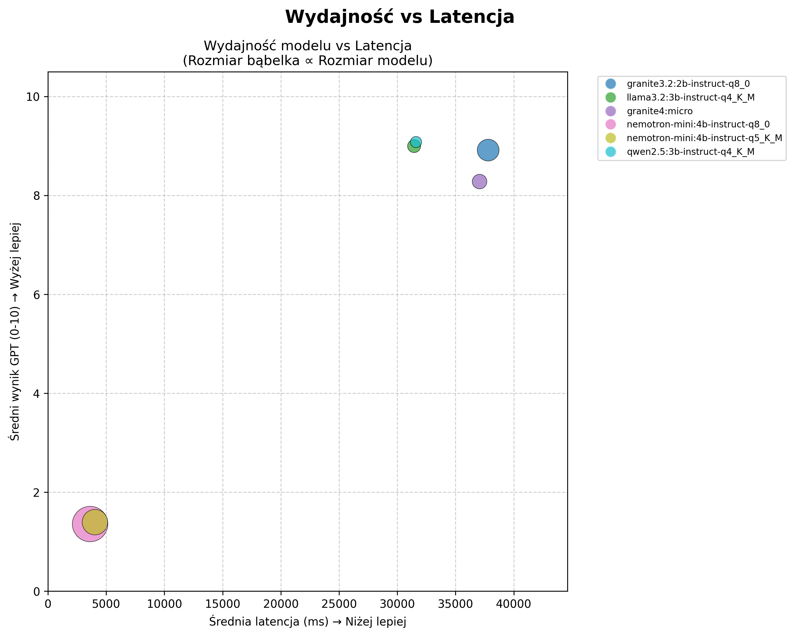

# Edge-LLM-Lab

Evaluate small language models under device constraints, with separate evidence
for task correctness, inference cost and application boundaries.

The framework combines frozen-reference replay, an existing simulator-driven
trajectory evaluator, portable capture storage, offline scoring and optional
Inspect AI tasks. Diabetes intake agents are worked examples. The reusable
referenced runner also accepts other JSON or text tasks.

## Research: quality and resource constraints

The historical study explored model and quantization choices for structured intake
agents, alongside response quality, latency, throughput, memory pressure and power.
Two evaluation modes serve different purposes: **referenced replay** holds the
conversation prefix fixed; **unreferenced simulation** examines an interactive
trajectory. Their results should be reported separately.

The recovered January 2026 exports illustrate why response quality and execution
cost need to be inspected together. In the selected referenced run, the fastest
configurations also received substantially lower judge scores. Speed alone would
therefore select a different configuration from a quality-oriented analysis.



*Original export dated 2026-01-18. Each point is a model configuration; lower latency
and higher judge score are preferable. Judge scores are not task success rates.
The export does not establish sample count, uncertainty or a controlled causal
comparison of optimizations. Bubble size follows the original model-size encoding.*

[Research figures and interpretation](docs/research/README.md) provide separate
quality, latency and power views, provenance, and a review of misleading legacy
charts. These are exploratory historical results, not a current model leaderboard
or evidence of clinical safety. Original figure labels are preserved in Polish;
new documentation and code use English.

The specialized intake agents remain worked examples. A modern comparison should
include a consolidated agent on the same held-out scenarios and budgets, measuring
whether specialization justifies its extra calls, latency and maintenance.

## Evaluation protocol

1. Define cases, allowed actions and budgets. Separate development and test cases
   by scenario family; tune only on development data.
2. Generate responses on the target device. Record the model/runtime hashes,
   prompt, tools, decoding settings, seed, request timings and failures.
3. Run heavy grading and plotting after capture, on a workstation if convenient.
   Preserve the original responses; changing graders must not rerun the target.
4. Report usefulness, boundary violations, measurement coverage and resource cost
   separately. Repeated seeds and turns are not independent patients.

Read the [full methodology](docs/methodology/evaluation-boundaries.md),
[architecture and migration boundaries](docs/methodology/architecture.md), and
[reusable example runner](examples/desktop/evaluate_dataset.py).

## Local example

The local referenced runner uses a GGUF file and a `llama-server` executable.
It does not require Ollama discovery, a judge-model key or experiment tracking.
The existing project environment uses Poetry; optional Inspect support is installed
with `python -m pip install -r requirements-inspect.txt`. The historical dependency set remains
heavy and is not a minimal mobile installation.

```bash
PYTHONPATH=src python examples/desktop/evaluate_dataset.py \
  --model /path/to/model.gguf --server /path/to/llama-server \
  --dataset examples/datasets/intake-boundaries.jsonl \
  --output runs/intake.sqlite --seed 11 --defer-scoring

PYTHONPATH=src python -m edge_llm_lab.evaluation.posthoc \
  runs/intake.sqlite --output runs/intake-scores.sqlite
```

Use `--profile text` for literal text references. The default structured profile
checks JSON agreement, including ordered tool calls and their arguments. It does
not silently repair invalid outputs or treat unavailable scores as zero.

SQLite stores indexed scalar measurements and trial metadata. Compressed,
content-addressed sidecar artifacts store transcripts. Copy the closed database
and its adjacent `.artifacts` directory together. Raw captures are ignored by Git;
review any exported results before publication.

For inline deterministic grading and offline figures, omit `--defer-scoring` and
add `--figures runs/report`. The report shows case-level agreement, individual
request times and evaluation coverage. Request wall time is distinct from total
trial duration, which can include model startup and other work.

## Inspect AI

The optional adapter shares case validation and graders with the local runner.
It supports native reference replay through an Inspect provider and scoring of
captured Edge-LLM-Lab responses without calling the target again.

```bash
PYTHONPATH=src inspect eval src/edge_llm_lab/integrations/inspect_ai.py@referenced_task \
  -T dataset="$PWD/examples/datasets/intake-boundaries.jsonl" \
  --model YOUR_PROVIDER/YOUR_MODEL --no-score

PYTHONPATH=src inspect eval src/edge_llm_lab/integrations/inspect_ai.py@captured_task \
  -T capture="$PWD/runs/intake.sqlite" --model mockllm/model --log-format json
```

The seven synthetic intake cases demonstrate policy routing, including benign
controls, contradictory data and attempts to override scope. They do not execute
tools or constitute clinical validation or a standardized security benchmark.
[The methodology](docs/methodology/evaluation-boundaries.md) explains what a larger,
clinician-reviewed and threat-specific study would require.

## Executed demonstration

On 2026-10-17, Qwen3.5-0.8B Q4_0 completed a one-case command smoke test
(1/1 exact match), followed by seven synthetic intake-routing cases (4/7 exact
matches, zero execution errors). The model failed the instruction-override case
and two clarification cases. This is a harness demonstration, not a model ranking
or medical safety assessment.

The run used Linux/CPU, llama.cpp build b11669, context 2048, output limit 128,
temperature 0 and seed 11. Request wall times exclude server startup but include
HTTP overhead. No controlled thermal, energy or cold/warm comparison was made.
Python 3.14 was used in the local experimental environment; the repository's
packaged dependency set still targets Python 3.10–3.13.

[Recorded configuration and scores](experiments/results/harness-demo-2026-10-17/intake-report/summary.json)
include model/runtime hashes. Model source:
[ggml-org/Qwen3.5-0.8B-GGUF](https://huggingface.co/ggml-org/Qwen3.5-0.8B-GGUF).

[Per-case results](experiments/results/harness-demo-2026-10-17/intake-report/case-scores.svg) and
[execution diagnostics](experiments/results/harness-demo-2026-10-17/intake-report/diagnostics.svg)
are available separately. In the diagnostic chart, request index is only the
ordinal position of a recorded request. It is useful for spotting unusually slow
requests; it is not an optimization axis or a comparison of models.

## Validation

Tests cover shared structured/text grading, reference leakage and family splits,
SQLite integrity and resume checks, runtime ownership, offline scoring, Inspect
replay, and plotting semantics. Plot tests use unequal turn counts, unscored trials
and known expected aggregates; SVG/PNG rendering runs without a display.

```bash
PYTHONPATH=src pytest tests/unit tests/test_posthoc.py
```

Inspect tests require the optional dependency. The [validation record](docs/methodology/validation.md)
records a pre-existing credential-registry test failure and remaining migration work.
See the methodology for limitations;
passing harness tests is not evidence that the evaluated model is safe.
