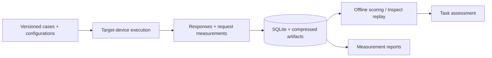
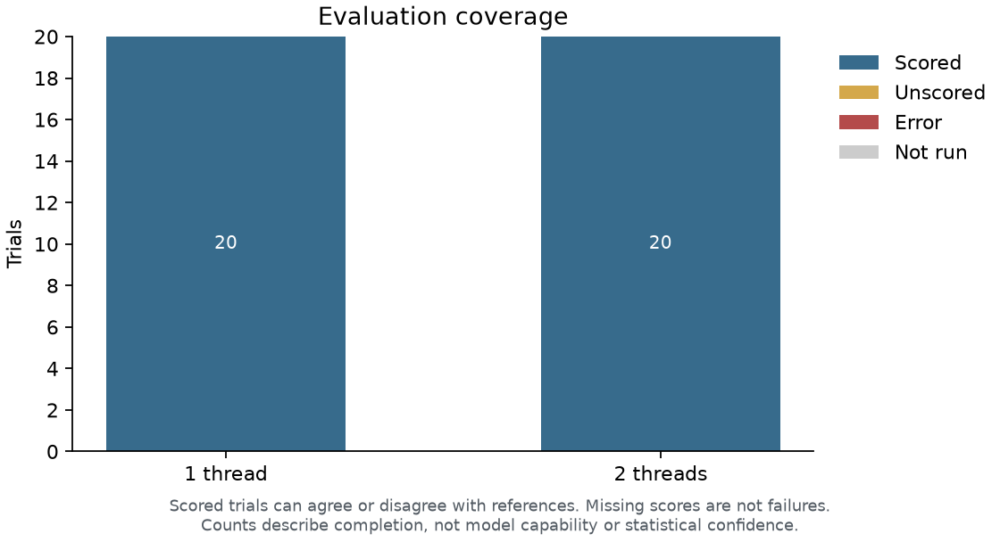
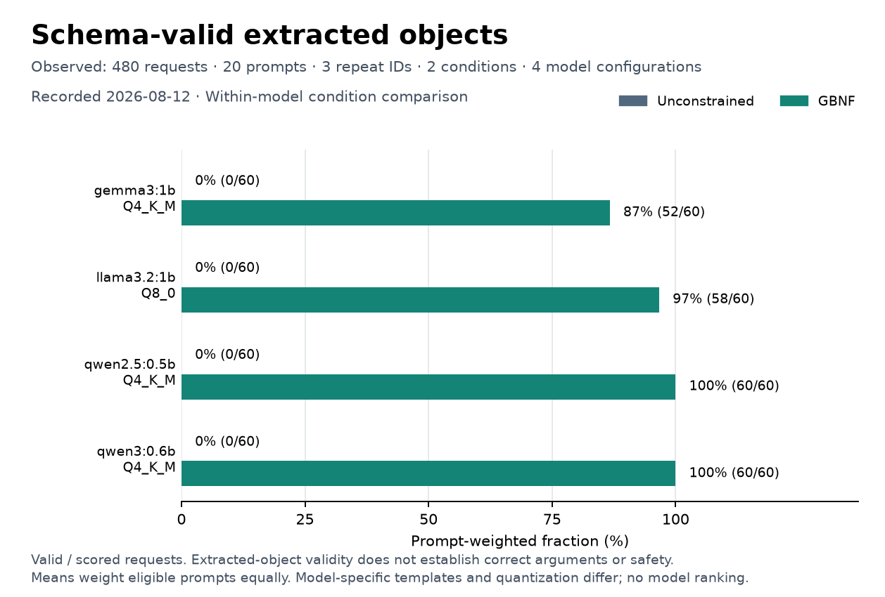
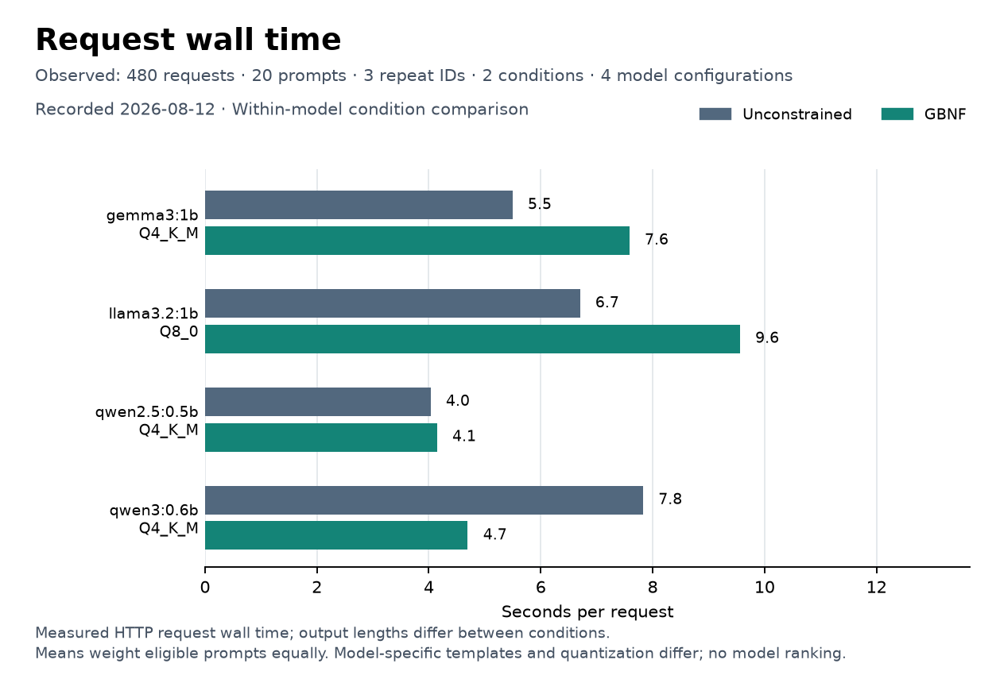
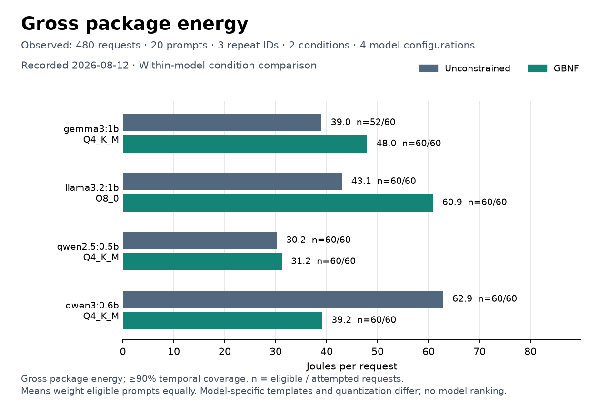
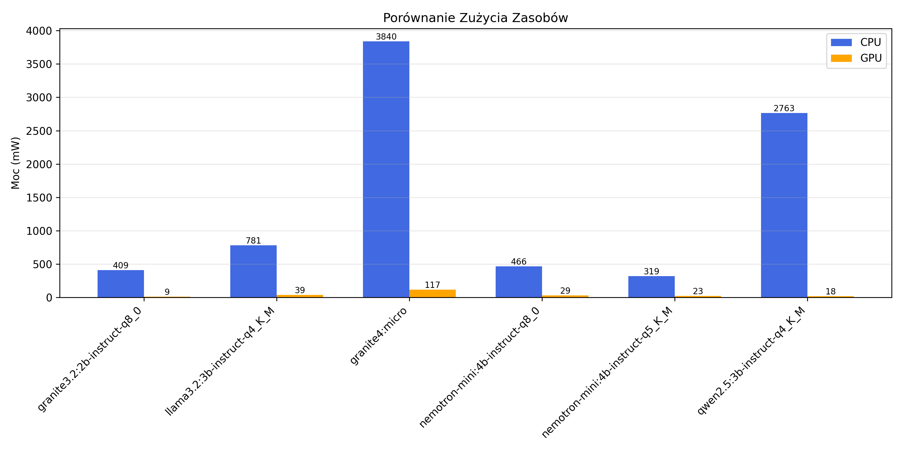

# Edge-LLM-Lab

**An evaluation harness for small language models under device constraints.**

Choosing an edge model means choosing a system: weights, quantization, decoding,
prompts and tools all affect whether a useful answer fits the latency, memory and
energy budget. Edge-LLM-Lab makes those choices measurable through controlled
response replay, simulated conversations and instrumented inference experiments.

The central question is: **what does a configuration gain in task performance,
and what does that gain cost on the device?** Structured intake agents provide a
worked example; the reusable replay path accepts other JSON and text tasks.

[Run an evaluation](#run-an-evaluation) · [Current reports](#current-reports) ·
[Historical research](#historical-research) · [Methodology](docs/methodology/evaluation-boundaries.md)

## What the harness does

A harness is the machinery that runs an evaluation: it presents inputs, controls
execution, captures outputs and measurements, applies scoring rules, and produces
an auditable result. A benchmark additionally needs a defined task population,
versioned cases and a scoring protocol. This repository supplies the machinery
and example studies; the seven-case example is not a standardized benchmark.

| Layer | Implemented behavior | Research purpose |
| --- | --- | --- |
| Cases | JSONL conversations, explicit dev/test splits, scenario-family checks | Keep references frozen and prevent known family overlap across splits. |
| Execution | Local GGUF through `llama-server`; seeds and configuration sweeps; compatible-run resume | Evaluate the same cases under recorded settings and retain failures. |
| Capture | SQLite metadata and scalar metrics; compressed, hashed response artifacts | Query measurements without repeatedly loading large conversation logs. |
| Assessment | JSON validity and exact structured/text agreement; offline scoring; optional Inspect replay | Change assessment without generating the target response again. |
| Analysis | Case-weighted scores, named-case timing, coverage; paired decoding-study reports | See both useful output and its execution cost, including missing observations. |



**Two protocols answer different questions.** In *referenced replay*, each
assistant target receives only the preceding frozen conversation. This controls
the input, but does not test recovery from the model's own earlier mistakes.
In *unreferenced evaluation*, a patient simulator responds to the agent and the
whole trajectory is assessed. That existing path is domain-specific and depends
on the simulator and expected outcome; it is not yet a generic tool environment.

The repository also contains a separate constrained-decoding experiment runner
with request timing and Apple Silicon power sampling. Its CSV results are analyzed
by the reporting layer. These experiments and the dataset harness have distinct
capture formats and measurement protocols; they are not silently pooled.

## Current reports

### Fresh execution: one CPU thread versus two

A new **2026-10-17 execution** evaluates
[Qwen3.5-0.8B Q4_0](https://huggingface.co/ggml-org/Qwen3.5-0.8B-GGUF) on 20 frozen synthetic
intake-routing cases with one and two CPU threads: **40 target-model requests**.
The same cases, prompt, model artifact, seed and output budget are used in both
conditions; configuration order alternates across cases. No judge model is called.

Both settings completed all trials and matched **12/20 references (60%)**, versus
**9/20 (45%)** for always declining. Mean observed request time was **6.69 s with
one thread** and **10.28 s with two**. More threads did not improve request time
in this run; the shared-host protocol does not support a general threading rule.

<table>
<tr>
<td width="50%"><a href="experiments/results/thread-study-2026-10-17/report/case-scores.svg"></a><br><b>Task agreement.</b> Which named cases match the frozen reference?</td>
<td width="50%"><a href="experiments/results/thread-study-2026-10-17/report/request-cost.svg"></a><br><b>Execution cost.</b> How much time does each case require?</td>
</tr>
<tr>
<td width="50%"><a href="experiments/results/thread-study-2026-10-17/report/paired-request-cost.svg"></a><br><b>Paired difference.</b> Does the same case become faster or slower with two threads?</td>
<td width="50%"><a href="experiments/results/thread-study-2026-10-17/report/coverage.svg"></a><br><b>Evidence coverage.</b> Are all expected trials accounted for?</td>
</tr>
</table>

*This is a small CPU execution study on a shared Linux host. One deterministic
observation per case and configuration supplies paired descriptions, not confidence
intervals. Request wall time excludes server startup. Changing thread settings
restarts the server; these are not controlled steady-state mobile measurements.*

The task chooses `record`, `clarify` or `decline`; it executes no tools and contains
no patient records. There are five record cases, six clarification cases and nine
decline cases, so **always declining scores 9/20 (45%)**. Privacy- and
injection-themed cases test the routing policy, not real access-control enforcement.

[Fresh-study protocol, configuration and reproduction](docs/research/current-reports.md#fresh-thread-comparison)
include hashes, the trivial baseline and measurement limits. The
[earlier seven-case smoke run](docs/research/current-reports.md#referenced-harness-demonstration)
is retained as a separate integration check.

### Does structured decoding improve format reliability, and at what cost?

The four figures below are newly generated from the **2026-08-12 recorded experiment**:
four 0.5B–1B model configurations, 20 prompts, three repeated seeds, unconstrained versus
GBNF-constrained decoding — 480 requests. It compares schema validity, request
wall time, output length and measured CPU/GPU/ANE energy. The validity metric checks the extracted JSON object against its schema; extraction
may recover JSON from surrounding text. It is not a strict-output or task-correctness
metric.

<table>
<tr>
<td width="50%"><a href="docs/research/figures/structured-decoding-validity.svg"></a><br><b>Format reliability.</b> Does the recovered JSON object satisfy the schema?</td>
<td width="50%"><a href="docs/research/figures/structured-decoding-latency.svg"></a><br><b>Request cost.</b> How long does each condition take?</td>
</tr>
<tr>
<td width="50%"><a href="docs/research/figures/structured-decoding-tokens.svg"></a><br><b>Output length.</b> Is the speed difference accompanied by a change in generated text?</td>
<td width="50%"><a href="docs/research/figures/structured-decoding-energy.svg"></a><br><b>Energy cost.</b> How much measured SoC energy does a request consume?</td>
</tr>
</table>

*Read the panels together: changing decoding can change the amount of text
produced, so a wall-time or energy difference does not isolate grammar-processing
overhead. Repeats share prompts and are not independent examples. The figure
reports descriptive summaries, not causal effects or a universal model ranking. Prompt templates and quantizations differ across models;
read each model as its own condition comparison.*

[Study design, aggregation and reproduction](docs/research/current-reports.md#structured-decoding-study)
include the input table, provenance and measurement limits. This is a new analysis
of existing measurements, not a new device run.

## Historical research

The earlier study investigated model and quantization choices for structured
intake agents: response quality, latency, throughput, resource pressure and
optimization settings. The selected original figures below come from a referenced
run exported on **2026-01-18**. Click a thumbnail for the full-size image.

<table>
<tr>
<td width="50%"><a href="docs/research/figures/scores.png"></a><br><b>Response quality.</b> Judge ratings on a 0–10 scale; not a success percentage.</td>
<td width="50%"><a href="docs/research/figures/latency_bars.png"></a><br><b>Latency.</b> Mean response time for the selected configurations.</td>
</tr>
<tr>
<td width="50%"><a href="docs/research/figures/scatter.png"></a><br><b>Quality–latency trade-off.</b> The fastest configurations received lower judge ratings in this run.</td>
<td width="50%"><a href="docs/research/figures/resources.png"></a><br><b>Power.</b> Reported CPU/GPU power in mW; not energy per task.</td>
</tr>
</table>

**Historical methodology.** These were exploratory evaluations of selected
scenarios under the models and hardware available at the time. Frozen-reference
replay and simulator-driven conversations were separate protocols. Turns and
repeated calls provide within-scenario observations, not additional independent
patients. These exports preserve the research record; their underlying per-example
measurements have not been recovered sufficiently to recompute weighting,
uncertainty or failure handling. They therefore support descriptive observations,
not population-level reliability claims.

[The historical gallery](docs/research/README.md) documents provenance, interpretation
and known chart defects. The images are unchanged original exports, including their
Polish labels. The current reports above use English labels and reproducible code.
Neither gallery requires a Neptune token.

## Run an evaluation

The packaged project targets **Python 3.10–3.13** and uses Poetry. Install the
project environment with `poetry install`, then prefix the Python commands below with `poetry run`
(or use an already activated project environment). The historical dependency set is
still broad; this is a workstation evaluation package, not an iOS application.
Supply a GGUF model and a compatible `llama-server` executable.

Run deterministic scoring inline and generate the named-case report:

```bash
PYTHONPATH=src python examples/desktop/evaluate_dataset.py \
  --model /path/to/model.gguf --server /path/to/llama-server \
  --dataset examples/datasets/intake-boundaries.jsonl \
  --output runs/intake.sqlite --seed 11 --figures runs/report
```

For an isolated device capture, defer all response grading:

```bash
PYTHONPATH=src python examples/desktop/evaluate_dataset.py \
  --model /path/to/model.gguf --server /path/to/llama-server \
  --dataset examples/datasets/intake-boundaries.jsonl \
  --output runs/capture.sqlite --seed 11 --defer-scoring

# Run on a workstation after copying the closed capture bundle.
PYTHONPATH=src python -m edge_llm_lab.evaluation.posthoc \
  runs/capture.sqlite --output runs/scores.sqlite
```

Copy the database **and its adjacent `.artifacts` directory** together. Offline
scores go into a separate database; the current plotting API reads the capture's
inline scalar scores, not that separate score database. Do not add `--figures`
to an unscored capture and interpret missing scores as failure scores.

### Bring your own task

Provide one JSON object per line with a case ID, family, split and conversation.
Assistant messages are the frozen targets; they are withheld until their turn is
scored. For example, this independent command task needs no intake-agent code:

```json
{"id":"window-01","family_id":"window-action","split":"test","conversation":[{"role":"user","content":"Return JSON with action and target: close the window."},{"role":"assistant","content":"{\"action\":\"close\",\"target\":\"window\"}"}]}
```

Use `--profile text` for literal text equality. The structured profile checks
JSON validity and exact agreement, including tool names and arguments. Neither
profile measures paraphrase quality or clinical correctness. The Python
[`evaluate_dataset`](src/edge_llm_lab/evaluation/dataset.py) API accepts multiple
seeds, configurations and an explicit split; keep tuning on `dev` and freeze `test`
for comparison. Resume requires a matching manifest.

### Optional Inspect AI assessment

```bash
python -m pip install -r requirements-inspect.txt
PYTHONPATH=src inspect eval src/edge_llm_lab/integrations/inspect_ai.py@captured_task \
  -T capture="$PWD/runs/capture.sqlite" --model mockllm/model --log-format json
```

The replay solver supplies the captured answer without calling the target model.
Its execution time is grading time, not device inference time. The adapter also
supports native provider-backed replay through `referenced_task`; see the
[Inspect workflow](docs/methodology/evaluation-boundaries.md#implemented-inspect-adapter).
Inspect integration provides an evaluation interface; security claims require
specified threats, attack cases, benign controls and application-level checks.

## Research protocol and extension points

A useful comparison holds the task, prompt budget and evaluation rule fixed while
varying the intended configuration. Record startup and steady-state measurements
separately; preserve errors and telemetry gaps. Score turns within trials, repeats
within cases, then cases equally. For uncertainty, resample independent cases or
families rather than treating every turn or seed as a new subject.

For an intake application, compare the historical specialized agents with a
consolidated baseline on the same held-out cases. Measure task completion,
boundary violations, calls and cost separately. Specialization is a hypothesis to
test, not a requirement imposed by the framework.

| Extend or inspect | Entry point |
| --- | --- |
| Case validation and trial orchestration | [Dataset evaluation](src/edge_llm_lab/evaluation/dataset.py) |
| Local server lifecycle | [Runtime](src/edge_llm_lab/runtime/server.py) |
| Capture storage and integrity | [Trial store](src/edge_llm_lab/storage/trials.py), [capture reader](src/edge_llm_lab/storage/capture.py) |
| Deterministic scoring | [Shared graders](src/edge_llm_lab/metrics/grading.py) |
| Dataset figures / decoding-study figures | [Dataset reports](src/edge_llm_lab/visualization/dataset_report.py), [paired reports](src/edge_llm_lab/visualization/paired_report.py) |
| Full methodology and migration status | [Evaluation boundaries](docs/methodology/evaluation-boundaries.md), [architecture](docs/methodology/architecture.md) |

Execution is currently sequential and the selected JSONL dataset is loaded into
memory. The generic replay path is more mature than the interactive simulator
path. Energy requires supported instrumentation; request wall time is not time
to first token. Native iPhone execution, generic simulator injection and a minimal
dependency distribution remain outside the implemented path.

## Validation

```bash
PYTHONPATH=src pytest tests/unit tests/test_posthoc.py
```

Tests exercise reference leakage, family splits, structured/text grading, capture
integrity and resume, runtime ownership, offline assessment, Inspect replay and
plot semantics. Plot tests check denominators, unequal repeat/turn counts, missing
measurements, labels and actual SVG/PNG rendering. See the
[validation record](docs/methodology/validation.md) for executed checks, the
real-model run and remaining migration boundaries.
